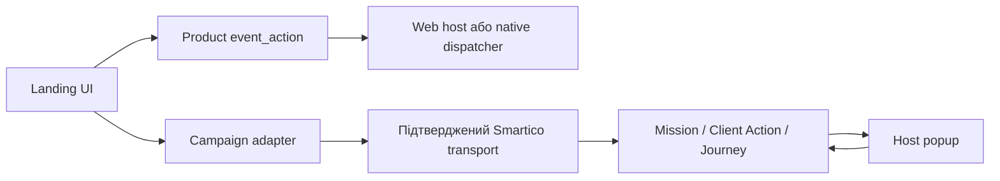

# Архітектура та iframe contract

## Межі відповідальності

| Шар | Володіє | Не повинен робити |
|---|---|---|
| Landing | дизайн, локалізований UI, дозволені API reads/actions через adapter, loading/errors | читати чужі cookies/parent SDK cross-origin, генерувати виграш, grant |
| Product host | auth, event_action dispatcher, parent scroll, iframe height, продуктова аналітика | підміняти невідомий mission state кліком |
| Smartico | mission/Journey lifecycle, сегменти, результат, bonus grant, engagement controls | визначати layout лендінгу |
| Native host | trusted WebView session/context, sockets або погоджений SDK, popup presentation, native routing | припускати, що web SDK автоматично є у кожному WebView |



Adapter — інтерфейс вашого коду, а не назва існуючого API Smartico. Спосіб реалізації залежить від підтверджених platform capabilities; [native](07-native-webview.md) описує межі.

## Поточний продуктовий Web contract

Канонічний `iframe-bridge.js` з `landing_doc/assets` копіюється без локальних змін, із pinned hash/version. Підключати синхронно перед app script. Зареєструвати token handler до handshake, викликати `init()` один раз. Схеми:

```ts
// Child -> parent
type ChildMessage =
  | { type: 'loaded'; payload: undefined }
  | { type: 'height'; payload: number }
  | { type: 'event_action'; payload: string };
// Parent -> child
type ParentMessage = { type: 'token'; payload: string | null };
```

```js
// Приклад після підключення канонічного bridge. Значення origin — із project contract.
IframeBridge.onParentMessage('token', receiveTrustedToken);
IframeBridge.init({allowedParentOrigins: ['https://stage.example.test']});
const {hasAuth, locale, theme} = IframeBridge.config;
```

`receiveTrustedToken` — ваша реалізація lifecycle з [04](04-state-and-time.md). `hasAuth` лише каже, чи варто очікувати токен; це не доказ identity/eligibility. `locale/theme` в embedded читаються з bridge config, не з довільного query parser. Підтриманий default canonical bridge — `en/light`; конкретний landing може мати власні standalone defaults.

URL iframe:

```text
https://landings.stage.example.test/summer-promo/?auth=true&locale=uk&theme=dark&parentOrigin=https%3A%2F%2Fstage.example.test
```

Токен не йде через query. Native top-level WebView не є `window.parent`; цей Web contract сам по собі не дає йому канал. Потрібна вже наявна або узгоджена native реалізація [07](07-native-webview.md). Не симулювати parent довільним інжектованим `postMessage('*')`.

## Origin і schema

`allowedParentOrigins` розширює historical defaults ядра, а не звужує їх. Зберегти canonical bytes; якщо фактичний token scope має бути вужчий, застосувати перевірений integration layer або запросити versioned core change у host owner. Перевіряти origin, actual parent/source та payload shape. Не довіряти `parentOrigin` тільки тому, що його передали в query.

Зафіксувати окремо origins для parent allowlist, API CORS, Smartico script/identify, media CDN і CSP frame ancestors. Успіх одного whitelist не доводить успіх інших. Origin — схема+host+port без path. Не додавати всі відомі Stage/localhost origins у Production.

## Loading handshake і height

Bridge автоматично шле `loaded/height` після load, а також height при resize/ResizeObserver. Не чекати lazy images для першого рендеру. У SSG перевірити, чи app ініціалізується до load; запізнілий handshake потребує перевіреного lifecycle adapter, а не нового message type.

Для long-scroll Web iframe scroll owner — parent. Child root має natural content height без `min-height:100vh`, що закріплює попередню висоту iframe. FAQ shrink: після transition/settled layout виміряти саме content root і через існуючий `height` надіслати додатне ціле, якщо воно змінилося. Не шукати max документного scrollHeight, якщо він уже містить стару viewport height; не запускати resize feedback loop.

Host має перевіряти height bounds, не створювати зайвий внутрішній scroll і повідомляти про visibility/viewport лише за погодженим контрактом. Child IntersectionObserver у розтягнутому iframe треба перевірити на реальному host: він не завжди означає, що блок видно користувачу в parent scroll.

## Capability contract

Не виводити platform capabilities з user agent. У current Web bridge немає `profile_info`, mission RPC, popup status, analytics forwarding, viewport чи `capabilities` message. Це можливі versioned розширення, не існуючий transport.

У [integration template](../templates/integration-contract.md) позначити для кожної платформи: `supported / unsupported / proposed`, owner і доказ. Якщо потрібний read API недоступний через CORS/App token, показати чесний recoverable UI і передати конкретний контрактний запит; не обходити same-origin policy та не підключати паралельний socket без узгодження.

## Subpath

Для `/<landing>/` всі локальні assets і chunks мають коректний base path. Перевірити прямий URL і host iframe `src`, trailing slash, redirect зі збереженням `auth/locale/theme/parentOrigin`. Немає права просити користувача міняти URL з cachebuster як постійне виправлення server cache. [Release](14-release-and-cache.md) описує це окремо.

Первинна основа: [pinned bridge contract](https://github.com/onlineTeran/landing_doc/blob/14f93e5c1f16ff349a52f10ec1c5bd1c2db47030/IFRAME-BRIDGE-INTEGRATION.md), [MDN postMessage](https://developer.mozilla.org/en-US/docs/Web/API/Window/postMessage).
