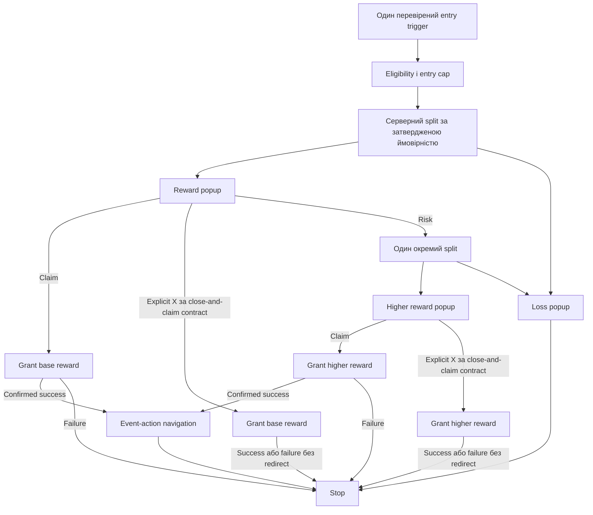

# Налаштування User Journey у Smartico BO

Використовувати для mission-triggered або Client-Action-triggered промо, аудитів branch/bonus routing та безпечного оновлення наявного flow. Спершу визначити механіку в [Smartico overview](05-smartico-missions-journeys.md). Цей runbook не припускає, що кожній акції потрібна mission.

## 1. План до Flow Builder

Підготувати entry contract, action matrix, bonus mapping та expiry rules. У кожної гілки має бути завершення: confirmed success, confirmed failure, no-action timeout, delivery failure. Хрестик, Escape, Back, backdrop і кнопка «Забрати» — окремі випадки.

Навчальний приклад **одного** Journey, не готова бізнес-механіка:



У прикладі explicit X видає ту саму винагороду свого outcome без redirect. Якщо бізнес задає іншу поведінку X, змінити окремий connector/branch й action matrix. Graph ілюструє структуру; повна action matrix має пріоритет.

| Вибір | Popup href прикладу | Винагорода | Навігація |
| --- | --- | --- | --- |
| Claim base | `dp:ok` | Base bonus | Лише після confirmed grant |
| Risk | `dp:cancel` | Поки немає | До next server branch |
| Explicit X, якщо погоджено | `dp:action&action=campaign_summer_close_claim_base` | Та сама base reward | За контрактом, може бути без redirect |
| Loss CTA | `dp:go&url=https://product.example/event_action/bonuses` | Немає | Supported product dispatcher |
| Passive close / reload / delivery failure | Немає explicit claim | Немає за цим прикладом | Немає |

`dp:cancel` не має універсального значення «програш»; це control, який ви прив'язали до risk. `dp:action` у popup може використовуватися як **точний engagement click identifier**. Не припускати, що кожен такий click одночасно відправляє named Client Action у native. [Відмінності](05c-smartico-client-actions.md).

## 2. Знайти або створити Draft

Перевірити selected ENV/Label/Brand і доступи. У Campaigns/Marketing знайти наявний Journey за campaign key. Прочитати entry/status/flow перед edit. Якщо user попросив виправити чинний Journey, змінювати його, а не створювати паралельний.

Для нового flow обрати Real-time Campaign/Journey або відповідний template. Clone/templates потребують заміни **всіх** placeholders: assets, bonuses, сегментів, dates, triggers, routes й conversion rules. Приклад template не сертифікує ці значення. [Campaigns](https://help.smartico.ai/welcome/products/crm-automation/create-journey-flow).

Назва Latin, наприклад `SC Summer QA Journey`; службовий description українською. Зберегти ID і Draft. Інтерфейс labels може відрізнятися; орієнтуватися на видимі поля, не автоматизувати guessed селектори.

## 3. Налаштувати один точний entry trigger

**Mission mode:** спершу готова mission/task. Знайти actual mission opt-in/completion/task event, який обраний у spec. Встановити exact mission/task filter у Query Builder. Перевірити на QA trace, що одна frontend operation дає одну entry. Не використовувати широке «будь-яка mission completed».

**Client Action mode:** trigger `Core: client action` або актуальний еквівалент із **точним** зареєстрованим action name, case і погодженими payload filters. [Налаштування й sender](05c-smartico-client-actions.md).

Якщо mission completion уже запускає Journey, не додавати другий Client Action entry «для надійності». Якщо потрібні два незалежні способи входу, явний backend дедуп/cap та acceptance мають покривати їх перетин.

У General/entry settings заповнити eligibility segment, control group, active period/daily hours, maximum duration, exact entry mode й доступні per-user caps. Перечитати фактичні values після save. Label-dependent max entries і timezone/rolling semantics перевірити в BO — [Campaigns](https://help.smartico.ai/welcome/products/crm-automation/create-journey-flow).

Рішення щодо re-entry, pending grant, `grantDayBasis`, atomic cap та окремих календарів приймаються за [Journey/reward model](../smartico-knowledge/03-journeys-and-rewards.md), а не default toggle. Додати boundary QA: pending до reset → Claim/X після → новий entry.

## 4. Спочатку template й creatives, потім Activities

За [popup KB](../smartico-knowledge/04-popups-and-routing.md) спершу вибрати actual authoring mode. Для підтриманого legacy mode за [popup runbook](06-smartico-popup-templates.md) зібрати reusable template й visual assets; не створювати окремий template лише заради title/icon/button count. Для Vibe зберегти actual popup resource і перевірити link exits до прив'язки activity.

У Flow Builder додати потрібні popup activities з **точними asset IDs**. Один loss asset може використовуватися кількома гілками, якщо content/actions однакові. Кожен occurrence залишається окремим engagement; router/dedup не спирається лише на resource ID.

Ймовірності задаються на Smartico split, сумарно 100%. Наприклад, два 50/50 rounds не доводять runtime independence або daily resampling: це перевірити за підтриманою split behavior й логами. Browser не генерує результат. Зміни ймовірностей потребують затвердженого business spec, не «підбору красивого demo».

## 5. Прив'язати clicks і закриття

На вихідному connector popup activity вибрати exact click condition/deep link. Broad `Any click` використати лише коли у popup одна дія й це відповідає contract. Інакше X/Claim/Risk можуть потрапити в ту саму гілку.

Для взаємовиключного вибору увімкнути **Close original engagement** на click connector. Це серверний захист від повторних eligible connectors; локальний click guard не замінює його. В офіційній [Campaigns documentation](https://help.smartico.ai/welcome/products/crm-automation/create-journey-flow#close-original-engagement-in-flow-builder) пояснено, що незакритий engagement може спрацювати повторно.

До explicit X з claim прив'язати ту саму бонусну сутність, що до Claim цього outcome, якщо бізнес-умови однакові. Окремий connector/activity не потребує третього «бонусу для X». Passive dismissal не перетворювати на explicit X action. Системний Back/закриття native overlay перевіряти окремо.

## 6. Grant, підтвердження й routes

У Bonus activity вибрати перевірений bonus template. Перевірити суму/FS, game/provider, wager, currency, expiry, caps, availability й тестове середовище. Назва `Win 100 FS` не робить QA placeholder бонусом на 100 FS.

Використати actual **Succeed/confirmed grant** output або документоване підтвердження вашої integration. Назва output сама не доводить видачу: перевірити tooltip, supported contract і те, чи підтверджує цей сигнал фактичний grant gaming platform. Не вести до бонусів на клік, timeout, queued/pending або generic «activity started».

Failure → Stop/погоджене повідомлення; pending → bounded wait/reconciliation за owner contract. Автоматичний повтор grant після невідомої відповіді дозволений тільки через серверну idempotency, не через повтор кнопки.

Deep Link activity після confirmed grant використовує підтриману навігацію:

```text
dp:go&url=https://product.example/event_action/bonuses
```

Окремий plain `/bonuses` чи brand-specific `/profile/bonuses` може працювати у браузері, але не в App dispatcher. Для нового продукту origin і action name беруться з його registry. [Event actions](03-event-actions.md), [native routing](../examples/native-smartico-routing.md).

## 7. Узгодити всі кінцеві умови

Для кожної activity перевірити delivery failure, no-action expiry й Stop. Maximum duration потрібна для завислих engagements, але вона не є правилом «на expiry видати бонус».

Окремо перевірити active until і **explicit stop date**. End of entry window може припинити тільки нові входи, а старі journeys продовжать flow. Якщо акція повинна припинити все у визначений момент, потрібне підтримане явне stop правило. Погодити, що робити з уже accepted/pending grants на boundary.

Усі campaign dates, mission recurrence і landing copy походять з однієї campaign spec. Зміна кінцевої дати означає audit BO й контенту, а не тільки заміну тексту в hero.

## 8. Save → re-open → QA → activate

1. Зберегти Draft flow; повторно відкрити entry settings і кожен критичний вузол/connector.
2. Перевірити всі asset/bonus IDs, exact links, probabilities, close-original flags, caps, durations, dates і terminal branches.
3. Підготувати маленьку action matrix для QA; потрібні Web та iOS/Android parity, не тільки BO preview.
4. За поточним authorized scope активувати потрібні assets/mission/Journey у правильному ENV. Не активувати «все в label».
5. Перевірити Campaign Status і Execution Status окремо: Active не завжди Running. Після редагування active flow врахувати propagation delay; re-open BO не доводить, що runtime уже застосував нову версію.
6. На узгодженому QA account провести branch tests, including failure, double/mixed click, reconnect, midnight й deadline. Grant-тест фіксується як окрема реальна дія, не «нешкідливий preview».

Звіт: Journey ID, trigger, segment/scope, status, node inventory, action/grant matrix, before/after values, доказ delivery/grant/routes і pending items. [QA](13-qa.md), [release](14-release-and-cache.md).
