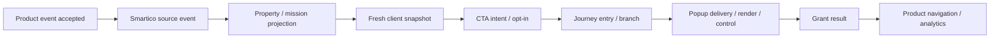

# Профілі продуктів, повторне використання та дослідження

Framework дає спільні правила й метод дослідження. SlotCity, CatBet і наступні продукти мають окремі **перевірені профілі інтеграції**. Профіль — приватний документ із посиланнями на фактичні контракти та environment matrix, не копія секретів і не набір припущень із сусіднього бренду.

## 1. Три рівні знань

| Рівень | Що тут зберігати | Як використовувати |
|---|---|---|
| Спільний framework | Patterns, workflows, інваріанти, джерела vendor, шаблони перевірки | Читати перед новою функціонально схожою задачею |
| Product profile | Підтримані Web/App capabilities, repo/CI, action registry, schema versions, бренд/локалі, environment map | Перевірити актуальність перед reuse; [template](../templates/product-profile.md) |
| Campaign kit | Правила, дати/timezone, CRM entity map, exact content/Figma, config і evidence конкретної акції | Не переносити IDs/мітки/бонуси до іншої акції без нового підтвердження |

Відомий бренд не означає відомий поточний контракт. У публічному framework назви SlotCity/CatBet задають цільові продукти; приватні tenant URLs, user IDs, missions, production labels та live marker names тут не фіксуються. Перший профіль заповнюємо з джерел, наступні кампанії перевикористовують його versioned facts.

## 2. Коли нову акцію можна зібрати самостійно

| Зміна | Що зазвичай достатньо | Що перевірити перед обіцянкою |
|---|---|---|
| Інші copy, assets, dates, outcomes у підтриманій механіці | Campaign config, CRM entities/creative values і QA | Reset/schedule, rewards, eligibility, product rules, asset budget |
| Інший named Client Action | Existing generic sender + новий explicit CRM mapping | Exact case/payload, sender readiness, trigger/filter/reentry/caps |
| Новий CMS widget на вже підтриманому navigation | Component/iframe за slot contract | Mount, sizing, auth CTA, event action support, impression ownership |
| Та сама участь із другого placement | Спільна state model й існуючий adapter | Одночасність, server caps, popup owner, reconciliation |
| Нова authoritative property/eligibility read | Data contract/producer і adapter change | Source/units/schema/freshness, API/CORS/native access |
| Нова host/native команда, acknowledgment або popup capability | Versioned platform work | Schema, owner, app build coverage, fallback, rollout |
| Нова payout механіка/atomic limit | CRM/backend capability investigation | Grant idempotency, concurrent entries, failure/retry, budget і policy |

Нове ім'я акції саме по собі не вимагає App release. Відсутній generic transport або новий тип routing може вимагати його. Не обіцяти «зробимо тільки CRM» до перевірки end-to-end contract.

## 3. Старт нової задачі для агента

1. Прочитати README/AGENTS, [surface workflow](19-surfaces-and-workflows.md), актуальний product profile і campaign kit. Якщо задача стосується Smartico — зайти через [KB](../smartico-knowledge/README.md), а не вважати всі відповіді вже відомими.
2. Сформулювати бажану user behavior і обрати landing/widget/popup або їхню комбінацію. Уточнити ENV і допустимі дії зі scope розмови.
3. Позначити кожну capability `supported / unsupported / proposed / unknown`, додати owner/version/evidence. Missing input перевірити у доступних джерелах; ставити питання лише про те, що справді лишилося невідомим.
4. Зіставити задум із pattern. Визначити config-only частину, CRM setup, frontend work і залежності host/backend/native. Це межі реалізації, а не привід зупиняти незалежну роботу.
5. Підготувати reviewable state/action/entity matrices і один вертикальний QA-сценарій. Окремо описати failure, stale data, duplicate actions, reset і account change.
6. Повернути конкретну відповідь: що підтверджено, як реалізувати, що ще дослідити, які перевірки засвідчать результат. Не підміняти Unknown упевненою вигаданою назвою API.

Для запиту «чи можна зробити X у Smartico» достатньо цільового дослідження capability. Не треба наперед вимагати всі production IDs або запускати повний release checklist. Для запиту «реалізуй X» дослідження завершується артефактами й доступною перевіркою, а не лише рекомендацією.

## 4. Investigate workflow: знайти перший розрив

Спочатку зафіксувати очікування, actual behavior, first/last known good, surface, ENV, build/config revision і synthetic/test-account role. Використати [investigation record](../templates/investigation-record.md). Не скидати місію й не додавати marker до зняття початкових доказів: це може приховати причину.

До пошуку fix встановити active source inventory: manifest/build entry → generated output → served revision → actual CRM Body/design/resource. У repo можуть лишатися старий `src/`, prototype і setup notes поряд із новим `app/`; знайдений старий transport не доводить, що саме він виконується зараз. Виправлення неактивного файла дає хибне відчуття прогресу.

Це evidence chain, не обов'язкова послідовність кожної акції. Informational popup не має grant, navigation teaser не має mission. Для обраного flow заповнюємо лише наявні кроки.

| Питання | Доказ | Типова помилка інтерпретації |
|---|---|---|
| Чи відбулася вихідна операція? | Authoritative product/backend event з часом/status/units | Відкриття каси прийняли за успішний депозит |
| Чи отримав її Smartico? | Профіль/event history у правильному label, sanitized event type | Відсутність marker прийняли за відсутність source event |
| Чи застосувалось правило? | Active trigger/filter, match branch, property/mission value | Property, segmentation і mission progress вважали одним станом |
| Що реально читає UI? | Sanitized response shape, identity epoch, freshness, actual build/config | BO уже оновився, а SDK/iframe ще показує старий snapshot |
| Чи прийнята участь? | Opt-in response + current cycle + Journey history | Click/loader прийняли за accepted entry |
| Чи доставлений і видимий popup? | Activity status, queue/suppression, rendered root, active session | Journey Then або Impression оголосили доказом усіх наступних кроків |
| Чи виконано choice/grant? | Connector event, pending context, bonus transaction/status | Перехід на grant node оголосили фактичним нарахуванням |
| Чи коректний звіт? | Population, event unit, dates, attribution/conversion rules | Entries назвали unique users, deposits — incremental revenue |

Кожний крок може бути `confirmed / contradicted / not observed / not applicable`. Відсутній доступ до журналу не доводить, що подія не відбулася. Після першого встановленого розриву перевірити його boundary; не змінювати одночасно frontend, Journey і reward rule без можливості визначити результат.

## 5. Робочий цикл перевірки гіпотези

1. Сформулювати перевірювану гіпотезу з передбачуваним спостереженням: «property в BO вже true, але client snapshot старіший за event».
2. Вибрати мінімальний read-only тест: порівняти timestamps/revisions, actual config й response без raw token/profile.
3. Відокремити source-event delay, CRM rule delay, client projection/cache і UI render delay. Підтверджений deposit не пропонувати повторювати через стару CTA.
4. Якщо потрібна мутація тестового контуру, зафіксувати попередній стан і точний scope. Test reset labels не рівнозначний mission reset або поверненню grant; [Smartico investigation](../smartico-knowledge/README.md).
5. Внести мінімальний fix у відповідальний шар, перевірити симптом та affected regressions. Повторне опитування state допускається bounded/backoff за контрактом; повторення financial action «для перевірки» — інша дія.
6. Зберегти висновок з confidence і scope. Не випускати правила «завжди» з одного браузера, користувача чи tenant.

## 6. Продукт із нуля

Для нового бренду пройти capability discovery до production механіки: auth/profile eligibility → origin/CORS/CSP → session/SDK readiness → permitted navigation → current participation state → accepted action → popup/native controls → server grant confirmation → lifecycle/account switch → analytics/release. Відсутній capability owner є dependency, а не permission змінювати чужу систему.

Тестове vertical slice може мати синтетичний reward і окрему аудиторію. Воно перевіряє transport/flow, але не сертифікує реальні bonus terms, native build або production segmentation. QA/Prod entity maps перевіряються окремо, особливо після clone.

## 7. Як поповнювати базу знань

Повторюваний висновок спочатку записати приватно як source/evidence; у shared framework перенести узагальнене правило, межі та спосіб перевірки. Product-specific constants лишаються у profile/kit. Оновити related docs/templates/QA разом, перевірити офіційні джерела, зазначити дату. Не вважати нову версію документації доказом того, що feature вже доступна в tenant або встановлена у host.

При зміні vendor workflow зберегти migration distinction: що підходить новим об'єктам, що працює історично, що треба перевірити до перенесення. Наприклад, рекомендація нового popup authoring не є наказом переписати робочі templates. [Maintenance](18-maintenance.md), [джерела](../SOURCES.md).
