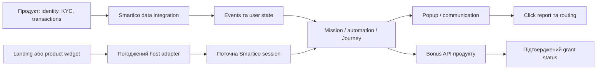

# 01. Модель Smartico та інтеграційні межі

## Одна механіка — кілька незалежних систем

Це концептуальна карта відповідальностей, не готова схема API. Продукт підтверджує особу, верифікацію й транзакції; Smartico оркеструє правила, прогрес, комунікації та запити винагород. Landing/widget показує стан і передає намір. У кожної стрілки потрібні owner, transport, timeout та доказ доставки. Видимий «виграш» у frontend не є записом бонусу в продуктовому bonus engine.

## Словник entities

| Поняття | Значення для проєктування | Що з ним не змішувати |
|---|---|---|
| Label | Контекст налаштувань та даних Smartico | Назву JS marker або мову UI |
| Brand | Продукт у конкретній multi-brand конфігурації | Автоматично окремий label або ENV |
| Environment | Stage/QA/Prod контур вашої інтеграції | Статус Draft/Active окремого entity |
| User profile | Поточні властивості користувача | Окрему транзакцію чи факт участі у циклі |
| Event | Подія з часом та payload | Стабільне user property |
| Segment | Умова добору аудиторії | Список усіх, хто вже зробив дію |
| Mission/task | Прогрес, opt-in, completion, recurrence | Journey або popup |
| Journey/campaign | Виконання flow після entry trigger | Автоматичний daily cap або гарантію grant |
| Popup resource/variation | Контент та локалізований вигляд | Popup template, delivery attempt чи бонус |
| Bonus template | Відображення та mapping винагороди | Конкретну видачу бонусу конкретному гравцю |

Multi-brand може означати кілька brands в одному label або окремі labels. У спільному label перевіряй brand filters, content variations, keys і bonus mapping; факт підтримки multi-brand не гарантує ізоляцію всіх конфігурацій. [Multi-brands support](https://help.smartico.ai/welcome/products/tools-and-guides/multi-brands-support).

## П'ять різних речей, які називають «міткою»

| Вид | Типове застосування | Джерело істини |
|---|---|---|
| User marker (`core_tags`) | Внутрішня сегментація, стан CRM | Smartico rules/profile operations |
| External marker (`core_external_markers`) | Ознака, що надходить з платформи | Продуктова data integration |
| JS marker (`core_public_tags`) | Публічний сигнал для frontend | Налаштований CRM/SDK contract |
| Label tag (`{{label.…}}`) | Підстановка контенту за правилами | Content configuration |
| Custom field entity | Додаткові дані mission/tournament тощо для custom UI | Entity schema та values у BO |

Перші три види розрізняє [User markers](https://help.smartico.ai/welcome/products/tools-and-guides/user-markers-tags); [Label tags](https://help.smartico.ai/welcome/products/tools-and-guides/label-tags) — інший механізм. [Custom fields/attributes](https://help.smartico.ai/welcome/products/tools-and-guides/custom-fields-attributes) належать entities, а не автоматично user profile чи правилам eligibility.

JS marker доступний frontend і може змінюватись через SDK. Тому його зручно використовувати як UI-сигнал, але він сам по собі не є захищеним дозволом видати бонус. Потрібна серверна перевірка первинної умови. Не записуй фінансові/персональні дані в public marker. Видалення marker не означає видалення mission completion, Journey history чи bonus history.

## SDK, API, REST та native — різні точки входу

Публічний API працює в контексті Smartico session. Перевірена [API reference](https://github.com/smarticoai/public-api) розділяє top-level `_smartico.*`, gamification `_smartico.api.*` та event callbacks. Backend REST keys із BO не є frontend ключами. Наявність методу у public reference не додає його до вашого iframe bridge.

| Поверхня | Хто володіє session | Як працює UI |
|---|---|---|
| Product page | Продуктовий Smartico service | Через чинний initialized/identified SDK |
| Cross-origin landing iframe | Зафіксований host/landing integration owner | Через погоджений adapter; parent object напряму недоступний |
| Product CTA widget | Host service | Стан та дії за widget contract |
| Smartico Vibe Widget | Existing host SDK за документацією модуля | Vendor embed, не довільний iframe протокол |
| Native app | Наявний native SDK/service | Погоджені native methods та popup wrapper |

Vibe Widgets — окремий vendor продукт для персоналізованих блоків logged-in гравців, з успадкуванням поточної host session. Це не обмеження для вашого власного promo widget, який може мати guest state. [Widgets](https://help.smartico.ai/welcome/products/vibe-studio/widgets).

## Мінімальний integration passport

Заповни приватно перед кодом:

- product, ENV, label/brand, дозволені origins та SDK/runtime version;
- session owner, спосіб readiness/identify, logout/account-switch lifecycle;
- source кожного UI-поля: KYC, eligibility, mission, cycle, remaining attempts, popup pending;
- exact sender для opt-in/Client Action/navigation; один owner для кожної дії;
- список доступних host/native capabilities, request/response correlation, timeout та recovery;
- state subscriptions, cache/freshness і спосіб безпечного teardown;
- popup authoring mode, renderer, communication policy та bonus integration owner.

Відмінності Stage/Prod — окремі environment values з перевіреної конфігурації. [Front-end integration](https://help.smartico.ai/welcome/technical-guides/front-end-integration) прямо вимагає окремі environment keys. Не перемикай API origin за неперевіреним query string.

## Lifecycle, який має пережити реальний продукт

Ініціалізація бібліотеки, завантаження label config і успішна identify — різні моменти. `identify` callback може повідомляти помилку; перевіряй її до user-scoped дій. `props_change` після початкового набору може передавати часткові зміни: відсутнє поле не означає false. Late subscription може пропустити readiness; повторний mount може накопичити handlers. [Callbacks reference](https://github.com/smarticoai/public-api/blob/81f2790f02424f01dadcbe979288f096cdc5d542/docs/Callbacks.md).

Практичний контракт: service зберігає нормалізований стан; компоненти підписуються на нього; account switch інвалідує попередні запити; cleanup прибирає тільки власні listeners. Не викликай глобальне очищення всіх SDK handlers із widget unmount. `init/online/logout` та підтриманий readiness gate звіряються з [поточною object reference](https://github.com/smarticoai/public-api/blob/81f2790f02424f01dadcbe979288f096cdc5d542/docs/SmarticoObject.md) і вашим integration code.

Для native потрібно перевірити session lifecycle, engagement delivery, action reporting та product routing окремо. Публічний [native protocol](https://github.com/smarticoai/public-api/blob/81f2790f02424f01dadcbe979288f096cdc5d542/docs/native/PROTOCOL.md) — reference для host team, не дозвіл додати другий socket у landing. Детальна реалізаційна межа — [Native WebView](../docs/07-native-webview.md).
